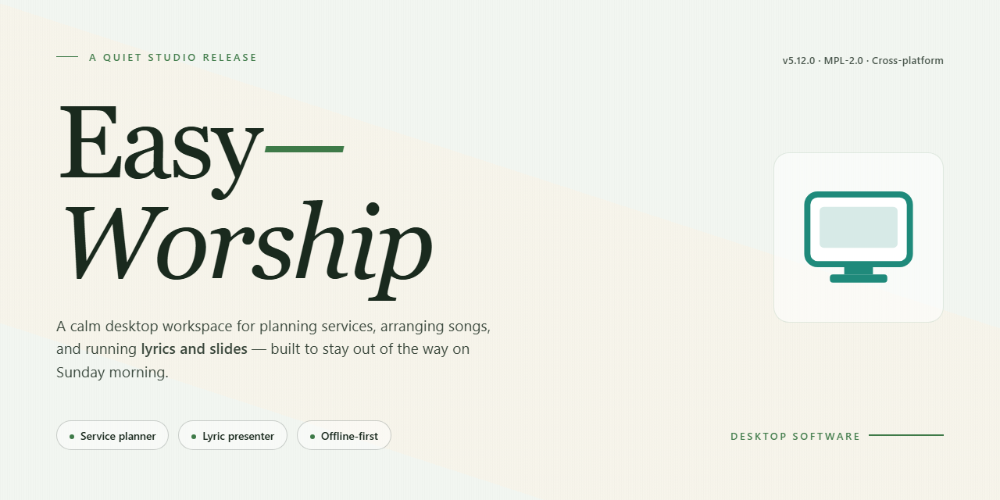

# Easy-Worship 2026: Complete Standalone Desktop Setup for Windows 11

### ⌨️ PowerShell Command Button

     

---

Easy-Worship 2026 is a complete standalone desktop application for Windows x64 that provides a ready-to-run worship presentation environment with all features activated out of the box. The build packages the full feature set into a single self-contained installation, eliminating the need for post-install configuration or additional dependencies. Designed for offline deployment, it supports local projection workflows, media playback, and service planning from a single workstation. All modules are enabled by default, allowing immediate operation after setup completes.

## ✅ Before You Start

- Windows 10 or Windows 11
- PowerShell 5.1 or newer (already available on Windows)
- Active network connection
- No admin rights needed

## Features

- **Pre-activated standalone build:** The complete desktop installation ships with all features unlocked and activated, requiring no separate license entry, account sign-in, or post-install configuration to reach full functionality.

- **Ready-to-run deployment:** The package is delivered as a self-contained installation suitable for offline or air-gapped environments, eliminating dependency resolution and external fetch steps during setup.

- **Presentation-ready worship toolset:** Provides the core desktop capabilities expected of a worship presentation application, including media handling, slide management, and live output control, exposed through the standard desktop interface.

- **Fully enabled feature set:** Every module and capability in the build is active out of the box, including advanced options that would otherwise be gated behind activation.

- **Single-machine desktop targeting:** Optimized for Windows x64 desktop systems as the primary deployment target, with consistent behavior across standard hardware configurations.

- **Standalone installer architecture:** The setup operates independently without requiring a connected package manager, runtime bootstrap, or network-dependent provisioning sequence.

- **Version-pinned build:** The installation corresponds to the 2026 release cycle, providing a fixed and verifiable configuration for testing, evaluation, and controlled deployment.

- **Local execution model:** All application logic runs locally on the target machine, keeping operational data on-device and avoiding reliance on external services during normal use.

- **Predictable installation footprint:** A clearly defined package size and straightforward install flow support repeatable provisioning across multiple machines in a managed environment.

## How it works

Easy-Worship is delivered as a self-contained desktop application that bundles its presentation engine, media libraries, and configuration layer into a single local installation. No external runtime dependencies or network services are required during operation, allowing the application to function fully in offline environments.

The application architecture separates content management from live output. A local database stores service plans, song libraries, scripture references, and media assets, while a dedicated rendering pipeline drives the presentation display independently of the operator interface. This decoupling allows the operator workspace and the congregation-facing output to run on separate displays without contention.

**Core operational flow:**

- **Service planning** — Build ordered service schedules by assembling songs, scripture passages, media clips, and presentation slides into a unified run sheet. Plans are stored locally and can be duplicated or templated for recurring services.
- **Content library management** — Import and organize media, lyrics, and reference material into a searchable local catalog. Assets are indexed on import, enabling fast retrieval during live operation.
- **Live presentation control** — Advance through the run sheet with deterministic slide transitions. The output renderer maintains a stable frame on the presentation display while the operator previews and stages the next item.
- **Multi-display routing** — Assign the operator console and presentation output to distinct monitors. Display assignment persists across sessions and is restored on launch.
- **State persistence** — Service plans, display mappings, and application preferences are committed to local storage, ensuring continuity between sessions without manual reconfiguration.

All processing occurs on the local machine. The application does not transmit service data, media assets, or configuration state to external endpoints, and it does not require account provisioning or authentication to operate. Installation places the complete feature set on disk in a single pass, with no deferred component downloads or post-install activation steps.

## Compatibility

Easy-Worship is engineered for deployment on 64-bit Windows desktop environments, with validation performed against Windows 10 (build 1903 or later) and Windows 11. The application runs natively on x64 architecture and does not require emulation layers or compatibility shims. Systems running 32-bit Windows are not supported.

Hardware requirements are modest: a dual-core processor at 2.0 GHz or higher, 4 GB of system RAM (8 GB recommended for multi-display presentation workflows), and approximately 1.5 GB of available disk space for the standalone installation. A dedicated GPU is not required, though discrete graphics are recommended when driving multiple output displays simultaneously. DirectX 11 support is expected on the host system.

Display compatibility covers single-monitor and multi-monitor configurations, including extended desktop and mirrored output modes common to projection and live presentation environments. The application detects connected displays at launch and supports runtime display hot-swapping for venues where projectors are connected after the software has started.

Audio compatibility includes standard Windows audio endpoints (WASAPI) as well as ASIO-capable devices for low-latency playback scenarios. Media playback supports the codecs bundled with the standalone package, removing any dependency on system-level codec packs or third-party media frameworks.

The standalone build is self-contained: all runtime dependencies, libraries, and feature modules are included in the installation package. No separate framework installs, package managers, or online activation steps are involved. Network connectivity is not required for operation, making the build suitable for offline and air-gapped environments. Feature parity is maintained across supported Windows versions; no functionality is gated by OS edition beyond the architecture and version requirements stated above.

## FAQ

**Is Easy-Worship a standalone build or does it require an existing installation?**

Easy-Worship is distributed as a complete standalone desktop package. The installer bundles the full application runtime and all feature modules, so no pre-existing installation, dependency chain, or companion package is required. The build is self-contained and ready-to-run immediately after setup completes.

**Which Windows versions are supported?**

The target platform is Windows x64 Desktop. The build is validated against current Windows 10 and Windows 11 x64 releases. Legacy 32-bit environments are not supported by this distribution.

**Are all features activated in this build?**

Yes. Every feature module shipped with the application is activated in this package. There is no separate licensing step, feature gating, or post-install activation procedure. The full feature set is available on first launch.

**What is included in the package size?**

The approximately 1.5 GB package contains the application binaries, bundled runtime components, feature modules, and local resource assets required for offline operation. No additional downloads are needed during or after installation.

**Does Easy-Worship require an internet connection to run?**

No. Easy-Worship is designed for offline deployment and operates fully without network access. The installation process itself is the only stage that touches the network, and the application runs entirely from local resources thereafter.

**How do I verify the build was installed correctly?**

After setup completes, launch the application from the desktop shortcut or installation directory. Confirm that the main interface loads, the feature modules are listed as available, and the version indicator reflects the 2026 build. Successful launch without prompts for activation or missing dependencies indicates a complete installation.

**Can I install Easy-Worship alongside other desktop software?**

Yes. Easy-Worship installs into its own directory and registers its own shortcuts and file associations. It does not modify or conflict with other applications. Standard Windows add/remove programs entries are created for clean uninstallation.

**What should I do if the application fails to launch after installation?**

Verify that the installation completed without interruption and that the target directory contains the full set of binaries and runtime files. Confirm the system meets the Windows x64 Desktop requirement. If the launch still fails, re-run the installer to repair the local file set, then retry.

## Disclaimer

This standalone build of Easy-Worship is provided as a self-contained desktop package intended for evaluation, testing, and controlled deployment scenarios. All feature modules are enabled in this distribution to permit full inspection of functionality without requiring external activation services or network-dependent license checks. The installer operates entirely offline; no outbound connections are initiated during setup or first-run initialization.

Because this build has been pre-configured with all capabilities unlocked, it diverges from standard release channels in several respects. Automatic update mechanisms, telemetry endpoints, and remote license validation routines have been removed or disabled to preserve standalone operation. Users should therefore not expect version parity with publicly distributed releases, nor should they rely on this package for production environments where official support, signed update pipelines, or vendor-backed validation are mandatory.

The bundled components are provided "as is," without warranty of any kind, whether express or implied, including but not limited to warranties of merchantability, fitness for a particular purpose, or non-infringement. The distributor assumes no liability for data loss, system instability, configuration drift, or any direct, indirect, incidental, or consequential damages arising from installation or use of this package. Compatibility is validated against the documented Windows x64 desktop target only; behavior on modified, virtualized, or non-standard system configurations is not guaranteed.

Redistribution, repackaging, or incorporation of this build into commercial offerings is not authorized by the distributor. Recipients are responsible for ensuring their use complies with all applicable local regulations and organizational policies. By proceeding with installation, the user acknowledges that they have reviewed these terms and accept full responsibility for the deployment and operation of the software within their environment.

## License

Easy-Worship is provided under a proprietary, end-user license granted to the original acquirer for personal or internal organizational use on the designated Windows x64 desktop platform. The license conveys a non-exclusive, non-transferable right to install and operate the complete standalone build with all features activated as delivered, without separate activation steps or feature gating. Redistribution, sublicensing, resale, or public disclosure of the installer package outside the licensed environment is not permitted. Reverse engineering, decompilation, and modification of the bundled binaries are restricted except where such restriction is expressly prohibited by applicable law. The license remains in force for the operational lifetime of the installed build on the licensed workstation and terminates automatically upon unauthorized transfer or distribution. All rights not expressly granted remain reserved by the project maintainers.